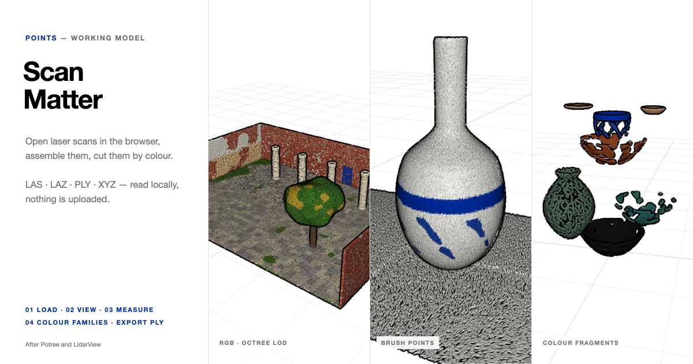

# Scan Matter — a Point-Cloud Workbench

**[Open the live workbench →](https://adpchrgruber.github.io/adp_adv_point_lab/)**



Open laser scans and photogrammetry clouds in the browser, assemble several of them in
one space, measure and clip them, and cut them into **colour families** — fragments you
can move and recombine. Everything runs locally: files are read on your computer and
never uploaded.

It combines the simplicity of [LidarView](http://lidarview.com/) (one page, drop a file,
it shows) with the strengths of [Potree](https://potree.org) (octree level of detail,
point budget, adaptive point size, eye-dome lighting, measuring and clipping).

## Use

1. **01 Load & assemble** — drop **LAS, LAZ, PLY, XYZ / TXT / CSV / PTS** files anywhere,
   use *Load scans…*, paste a URL, or open the page with `?url=https://…/scan.laz`.
   Each scan gets an octree on load (in a background worker). Click a scan in the list
   or in the view to select it, then **G** move · **R** rotate · **X** scale.
   *Up* swaps Z-up (survey, LAS) and Y-up (many PLY / photogrammetry exports),
   *Ground* sets it on the ground plane, *Copy* duplicates it.
   Georeferenced scans of the same area keep their real relative positions; anything
   else is placed next to what is already there.
2. **02 View** — colour by **RGB, Height, Intensity, Class** (ASPRS codes) or **Family**.
   *Size* with *Adaptive* sizing (follows the octree level, so the cloud stays closed at
   every distance) or *Fixed px*. *Budget* is the most points drawn at once.
   *EDL* shades points by the depth of their neighbours and outlines silhouettes.
   Views Top / Front / Side / Iso, turntable (Space), **W A S D Q E** to fly.
   **Point shape**: square, circle, triangle, oval, sphere (lit from the upper left),
   cube (isometric, three shaded faces), spike (four-pointed star), ring — and two
   generative ones: **shard** (each point a randomly turned, irregular splinter) and
   **brush** (tapered strokes that follow a smooth flow field across the scene, so the
   cloud reads like a painting).
3. **03 Measure & clip** — **Point** (I) reads a point's source coordinates (real-world
   values for georeferenced files), colour, class and family. **Dist.** (M) and
   **Height** (H) measure between two points. The **clip box** keeps or cuts what is
   inside; *Clip → scan* turns the result into a new scan.
4. **04 Colour families** — clusters the colours of every visible scan together
   (k-means in CIELAB, 2–16 families). Click a swatch to hide a family, Shift-click to
   isolate it. **Split into scans** makes every visible family of every visible scan a
   fragment of its own — select one and move it.
   **Family edges** — morphology on the labels: *Grow* lets the visible families take
   over neighbouring points of hidden ones, *Shrink* gives their edge points away,
   *Clean* gives every point the most common family around it (removes speckles and
   fringes before cutting).
5. **05 Analyse & cut** — image-processing methods carried over to 3D: the
   "neighbouring pixels" of a point are the points within *Radius* × the scan's point
   spacing.
   **Geometry** computes normals, curvature, roughness and shape (linear / planar /
   scattered, from the covariance of each neighbourhood; sparse regions widen their
   radius) — colour by **Curv.**, **Rough.**, **Shape**, or **Shade** by surface direction.
   **Magic wand** floods from a clicked point through neighbours of similar colour
   (ΔE in CIELAB ≤ *Tolerance*); Shift-click adds; **Cut** makes the patch and the rest
   two scans. **Split into pieces** — connected components: every visible family (or
   the whole scan) falls apart into the pieces that physically hold together.
6. **06 Transform** — **Pixel sort**: in vertical strips the colours above a brightness
   threshold are sorted (by brightness or hue) and laid back bottom to top, as in
   glitch-art pixel sorting; *Restore* undoes it. **Stipple**: a new scan in which
   dark points survive and light ones drop out, drawn as ink dots of the original size.

**Output** — *Export PLY* writes every visible point — assembled, clipped, with hidden
families left out — as binary PLY (double x y z, Z up, georeferenced, plus RGB,
intensity, classification and family): opens in CloudCompare, Rhino, Blender,
MeshLab. *Screenshot* saves a PNG, *Record turn* one turntable revolution as video.

### Presets

| Preset | |
|---|---|
| Courtyard | 2.6 M points — stone floor with moss, brick walls with plaster, rust and a blue door, a colonnade, a tree |
| Vessels | 1.2 M points — celadon jar, raku bowl, porcelain bottle on a plinth: made for colour families |
| Terrain | 6 M points — 600 m valley with forest, rock, snow and water, classified, georeferenced: a level-of-detail test |

### Example files (`examples/`)

| File | |
|---|---|
| `arch.las` | brick portal, LAS 1.2 point format 2, georeferenced |
| `bowl.ply` | raku bowl, binary PLY with RGB |
| `boulder.xyz` | boulder with lichen, ASCII `x y z r g b` |

Generated by `tools/make_examples.py` (Python 3, standard library only).

## How it works

- **Reading** happens in a Web Worker: LAS 1.0–1.4 (point formats 0–10), LAZ through
  [laz-perf](https://github.com/hobuinc/laz-perf) (fetched from the CDN only when a .laz
  file is opened), PLY (ASCII and binary), and delimited text with column detection.
  Clouds over 40 M points are decimated on read.
- **Octree** (after Potree's converter): each node keeps one point per cell of a 128³
  grid, taken in random order so it is an even subsample; the rest fall to its eight
  children. Points are stored node by node, so each node is one slice of the arrays.
- **Level of detail** (after Potree): every frame the nodes are opened in order of their
  size on screen until the point budget is spent; nodes outside the view are skipped.
- **Adaptive point size** (after Potree): the drawn nodes are encoded in a small texture
  (child mask and offset per node); the vertex shader walks it to the deepest drawn node
  around each point and sizes the point by that level's spacing.
- **Eye-dome lighting** (Boucheny 2009, as in Potree and CloudCompare): points render
  into a target with a depth texture; a full-screen pass darkens each pixel by how much
  nearer its neighbours are, in log depth.

## Credits

Ideas are borrowed, the code is written fresh for this page.

- **[Potree](https://github.com/potree/potree)** — Markus Schütz, TU Wien (BSD-2-Clause):
  octree sampling, screen-size-ordered traversal with a point budget, visible-node
  texture for adaptive point size, EDL pass, clip box and measuring tools.
- **[LidarView](http://lidarview.com/)** — xtsense: one-page local viewer, decimation to a
  point buffer, colour modes, WASD fly keys, the *Animate* turntable, `?url=` loading.
- **Eye-dome lighting** — Christian Boucheny, *Visualisation scientifique de grands
  volumes de données*, 2009.
- **[laz-perf](https://github.com/hobuinc/laz-perf)** — Hobu Inc. (Apache-2.0), used as is
  for LAZ decompression.
- **[three.js](https://threejs.org)** (MIT).

## Run locally

Single self-contained `index.html`, no build step; three.js from the CDN. Example
files need http:

```bash
python3 -m http.server
```

## Repository layout

```
index.html        the whole app (HTML, CSS, worker and JS module)
examples/         example scans (LAS, PLY, XYZ)
tools/            generator for the examples
docs/preview.png  social / README preview image
```

## Scripting

The page exposes `window.points` in the browser console:

```js
points.loadPreset('terrain')
points.loadURL('examples/arch.las')
points.params.k = 8; points.runFamilies()
points.splitFamilies()
points.computeGeometry(); points.setColor('shape')
points.splitPieces(); points.morphFamilies('clean')
points.pixelSort(); points.stipple()
points.exportPLY()
points.render()            // draw one frame (e.g. when the tab is in the background)
```
